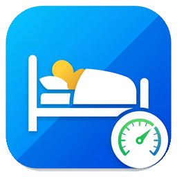

<p align="center"></p>

# Occupation du lit (`ha_lit_occupancy`) — Home Assistant

[](https://my.home-assistant.io/redirect/hacs_repository/?owner=maximeblanchard&repository=ha_lit_occupation&category=integration)
[](https://my.home-assistant.io/redirect/config_flow_start/?domain=ha_lit_occupancy)

Intégration personnalisée Home Assistant qui transforme un capteur de poids brut (ex. cellules de charge HX711 sous ESPHome, sujettes à la dérive du zéro ou à une tare à `0 kg` lors d'un redémarrage en pleine nuit) en une détection fiable de **qui est dans le lit**, avec **auto-calibration de la tare** et **auto-apprentissage du poids des occupants**.

---

## 📊 Indicateurs et entités fournis

Un appareil **Occupation du lit** est créé avec les entités suivantes :

### Capteurs de présence (`binary_sensor`)

| Entité | Description |
|---|---|
| `binary_sensor.lit_occupe` | `on` si au moins une personne est détectée dans le lit |
| `binary_sensor.<nom>_sur_le_lit` | Un capteur par personne déclarée (`on` si cette personne est détectée dans le lit) |

Chaque capteur binaire expose également en attributs :

| Attribut | Description |
|---|---|
| `poids_brut` | Valeur brute actuelle remontée par le capteur source (kg) |
| `baseline` | Valeur de référence actuelle du lit vide (kg) |
| `delta` | Différence brute `poids_brut - baseline` (kg) |
| `confiance_elevee` | `true` si l'écart avec la combinaison retenue est dans la tolérance configurée |
| `personnes_detectees` | Liste des prénoms actuellement détectés sur le lit |
| `derniere_calibration` | Date/heure de la dernière calibration automatique ou manuelle de la baseline |
| `poids_initial_kg` | *(Sur l'entité d'une personne)* Poids approximatif saisi lors de la configuration |
| `poids_appris_kg` | *(Sur l'entité d'une personne)* Poids affiné automatiquement par l'intégration |
| `echantillons_apprentissage` | *(Sur l'entité d'une personne)* Nombre de paliers stables appris |
| `ecart_moyen_kg` | *(Sur l'entité d'une personne)* Variabilité moyenne observée (kg) |

### Capteurs de poids (`sensor`)

Les capteurs numériques ont `device_class: weight` et `state_class: measurement` : ils alimentent les statistiques à long terme de Home Assistant et peuvent être tracés dans vos graphiques historiques.

| Entité | Description |
|---|---|
| `sensor.poids_estime_sur_le_lit` | **Vrai poids estimé sur le lit** ($\ge 0\text{ kg}$), corrigé de la baseline et insensible aux reboots/tares à `0 kg` de l'ESP |
| `sensor.poids_appris_<nom>` | **Poids appris actuel** de chaque occupant (kg), mis à jour au fil des nuits |

### Boutons d'action (`button`)

| Entité | Description |
|---|---|
| `button.recalibrer_lit_vide_maintenant` | Force immédiatement l'état « lit vide » et aligne la baseline sur la valeur actuelle du capteur |
| `button.reinitialiser_les_poids_appris` | Réinitialise les poids appris de toutes les personnes à leurs valeurs initiales configurées |

---

## 🚀 Installation

### Via HACS (recommandé)

[](https://my.home-assistant.io/redirect/hacs_repository/?owner=maximeblanchard&repository=ha_lit_occupation&category=integration)

Le bouton ouvre directement votre instance Home Assistant sur la boîte de dialogue HACS.

Sans le bouton, manuellement :
1. HACS → menu ⋮ → **Dépôts personnalisés**
2. Ajouter l'URL `https://github.com/maximeblanchard/ha_lit_occupation`, catégorie **Intégration**
3. Installer **Occupation du lit**, puis redémarrer Home Assistant

### Manuelle

1. Copier le dossier `custom_components/ha_lit_occupancy` dans `config/custom_components/`
2. Redémarrer Home Assistant

---

## ⚙️ Configuration

Paramètres → Appareils et services → Ajouter une intégration → **Occupation du lit**

[](https://my.home-assistant.io/redirect/config_flow_start/?domain=ha_lit_occupancy)

1. **Paramètres généraux** :
   - **Capteur de poids source** : l'entité renvoyant le poids brut du lit (ex. `sensor.esp_lit_poids`).
   - **Valeur de départ (baseline)** : laissez `0` (elle se recalibrera toute seule dès le premier état vide).
   - **Tolérance (%)** : marge acceptée autour du poids attendu (`15 %` par défaut).
   - **Stabilité requise (s)** : durée pendant laquelle un nouvel état doit rester stable avant d'être validé (`4 s` par défaut), pour filtrer les mouvements dans le lit.
   - **Apprendre et affiner automatiquement le poids des occupants** : activé par défaut.
2. **Occupants** :
   - Ajoutez chaque personne susceptible de dormir dans le lit avec son **prénom** et un **poids approximatif de départ** (jusqu'à 6 personnes).

Tous ces paramètres restent modifiables à tout moment via le bouton **Configurer** de l'intégration.

---

## 🧠 Fonctionnement détaillé

### 1. Insensible aux reboots du capteur dans le lit (`0 kg` $\rightarrow$ `-80 kg`)
Les capteurs de poids type HX711 sous ESPHome refont souvent leur tare à `0 kg` au démarrage :
- **Si le capteur démarre pendant que tu es dans le lit** : il indique `0 kg`. Quand tu te lèves, le poids brut passe à `-80 kg`. Dès que ce palier négatif est stable, l'intégration détecte que la valeur est inférieure à la baseline actuelle, **recalibre automatiquement la baseline à `-80 kg`** (lit vide) et utilise même ce saut de `80 kg` pour affiner ton poids. Quand tu te recouches et que le capteur affiche `0 kg`, le delta ($0 - (-80) = +80\text{ kg}$) te détecte normalement et `sensor.poids_estime_sur_le_lit` affiche bien `80 kg`.
- **Si l'ESP redémarre pendant la nuit** alors que tu étais déjà détecté dans le lit (passage par `unavailable` puis retour à `~0 kg`), la baseline est immédiatement décalée de $-\text{poids des occupants}$ sans perdre ta présence.

### 2. Auto-apprentissage du poids et variations (habillé + PC vs nu)
- **Affinage automatique** : lorsqu'une personne seule est confirmée sur le lit et stable pendant ~20 secondes, la médiane des mesures affine progressivement son poids (`sensor.poids_appris_<nom>`), rapidement sur les 10 premiers cycles puis en douceur ensuite (dans une limite de sécurité de $\pm 25\%$ autour du poids initial).
- **Tolérance aux accessoires (vêtements, PC portable, livre)** :
  - La détection intègre une marge positive supplémentaire (`+3,5 kg` par personne) pour ne pas fausser la reconnaissance si tu viens dans le lit habillé avec un ordinateur portable.
  - Au-delà de `+1,5 kg` au-dessus du poids habituel déjà appris, la vitesse d'apprentissage est automatiquement divisée par 4 afin qu'un objet posé temporairement sur le lit ne fasse pas dériver ton poids corporel de référence.
- **Sauvegarde persistante** : la baseline et les poids appris sont enregistrés dans `.storage/ha_lit_occupancy_state_<entry_id>` et sont restaurés au redémarrage de Home Assistant.

---

## 🔧 Dépannage

Pour obtenir des logs détaillés, ajoutez dans `configuration.yaml` :

```yaml
logger:
  logs:
    custom_components.ha_lit_occupancy: debug
```

## 📄 Licence

MIT
